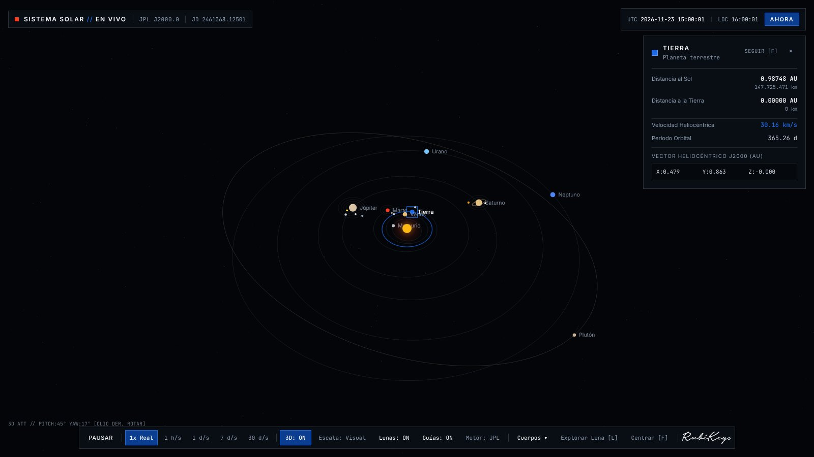
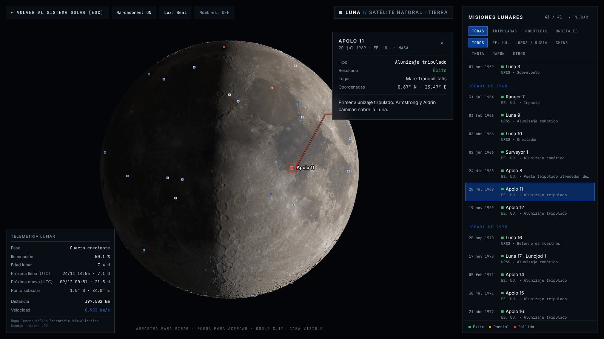

# Wallpaper Solar

Simulación del Sistema Solar en tiempo real como **fondo de escritorio animado e interactivo para Windows**:
vive detrás de los iconos del escritorio, responde al ratón y al teclado, se pausa cuando hay algo a pantalla
completa e incluye una vista lunar con un globo 3D y el catálogo de misiones a la Luna.




---

## 1. Stack tecnológico

| Capa | Tecnología | Para qué |
|---|---|---|
| Aplicación de escritorio | **Python 3.10+** | Proceso principal: ventana, bandeja, integración con Windows |
| Ventana web | **pywebview 5+** sobre **Microsoft Edge WebView2** | Muestra la simulación (HTML) a pantalla completa en todo el escritorio virtual |
| Integración con Windows | **ctypes + Win32 API** | Incrustación detrás de los iconos (`Progman` / `WorkerW`), hooks globales de ratón y teclado (`WH_MOUSE_LL`, `WH_KEYBOARD_LL`), DPI por monitor, multimonitor, detección de pantalla completa, instancia única (mutex) |
| Bandeja del sistema | **pystray** + **Pillow** | Icono y menú (modo interactivo, HUD, inicio con Windows, desinstalar…) |
| Inicio con Windows | **winreg** | Entrada `HKCU\…\CurrentVersion\Run` (respeta lo que se desactive desde el Administrador de tareas) |
| Simulación | **JavaScript (módulos ES)** + **Canvas 2D** | Sistema Solar, física y HUD |
| Globo lunar | **three.js** (WebGL) | Esfera con el mapa de la LRO, luz solar real y marcadores de misiones |
| Estilos | **Tailwind CSS 3** + fuentes **Inter** / **JetBrains Mono** (Fontsource) | Interfaz estilo centro de control; todo local, sin conexión |
| Compilación web | **Vite** + **vite-plugin-singlefile** | Junta JS, CSS, fuentes e imágenes en **un único `index.html`** (WebView2 no carga módulos JS desde `file://`) |
| Ejecutable | **PyInstaller 6** | `WallpaperSolar.exe` en modo carpeta, sin consola |
| Instalador | **Inno Setup 6** | Instalación por usuario y desinstalación limpia |
| Calidad | **pytest** + **ruff** | Tests (sin necesidad de Windows) y revisión de código |

**Datos y modelos astronómicos**

- Planetas: elementos keplerianos J2000 del JPL (Standish), con sus tasas por siglo.
- Lunas: elementos osculantes de **JPL Horizons** (época 23-nov-2026) con el movimiento medio real; error < 0,4° frente a Horizons entre 2026 y 2030.
- Luna: teoría lunar de **Meeus** (*Astronomical Algorithms*, cap. 47); fase, próximas llena/nueva y punto subsolar (cap. 53), contrastados con JPL Horizons.
- Motor alternativo: integrador gravitatorio N-cuerpos **Velocity Verlet**.
- Mapa lunar: **NASA's Scientific Visualization Studio** (CGI Moon Kit, datos LRO).

### Cómo encajan las piezas

```
┌──────────────── Python (src/wallpaper_solar) ─────────────────┐
│  main.py ─► app.py ─┬─ window.py   ventana WebView detrás de los iconos (WorkerW)
│                     ├─ hooks.py    ratón/teclado del escritorio ──┐
│                     ├─ tray.py     menú de la bandeja             │
│                     ├─ settings.py / autostart.py / log.py        │
│                     └─ bridge.py   cola JS + agrupación de arrastres
└────────────────────────────────────────────────────┬───────────┘
                                window.evaluate_js(…)│  window.__wallpaperBridge.clickAtClient / panBy / wheelAt / shortcut…
┌──────────────── HTML (web/dist/index.html) ────────▼───────────┐
│  web/src: física (physics/), dibujo (render/), HUD (ui/),       │
│  vista lunar (moon/), datos (data/), puente (bridge.js)         │
└─────────────────────────────────────────────────────────────────┘
```

El WebView queda detrás de los iconos y Windows no le entrega el ratón; por eso los **hooks globales** observan
la entrada de todo el sistema y, cuando ocurre sobre el escritorio libre, la reenvían al HTML por el puente.

### Estructura del proyecto

```
src/wallpaper_solar/     Aplicación Python
  win32/                 Todo lo que habla con Windows (ctypes)
web/                     Simulación (Vite)
  index.html             Marcado del HUD
  src/                   Módulos JS: physics/, render/, ui/, moon/, data/, input/, styles/, assets/
build/                   wallpaper.spec (PyInstaller), installer.iss (Inno Setup), build.ps1, icon.ico
tests/                   pytest
docs/img/                Capturas del README
run.py                   Lanzador de desarrollo
```

---

## 2. Instalación y desinstalación

### 2.1 Instalar la aplicación (usuarios)

Requisitos: **Windows 10 u 11 de 64 bits** con **Microsoft Edge WebView2 Runtime** (viene de serie en
Windows actualizados; si falta, el instalador lo avisa y ofrece la descarga).

1. Descarga `WallpaperSolar-Setup-<versión>.exe` desde *Releases*.
2. Ejecútalo. Como el instalador no está firmado, Windows SmartScreen puede mostrar
   «Windows protegió tu PC»: *Más información → Ejecutar de todas formas*.
3. No pide permisos de administrador: se instala para tu usuario en `%LOCALAPPDATA%\Programs\WallpaperSolar`.
4. Opciones: **Iniciar con Windows** (recomendado) e **Iniciar Wallpaper Solar ahora**.

Para actualizar, instala la versión nueva encima: conserva los ajustes.

### 2.2 Desinstalar

Cualquiera de estas tres vías:

- Icono de la bandeja → **Desinstalar Wallpaper Solar…**
- *Configuración → Aplicaciones* → **Wallpaper Solar** → Desinstalar
- Menú Inicio → **Desinstalar Wallpaper Solar**

La desinstalación cierra la aplicación y elimina **todo** rastro:

| Qué | Dónde |
|---|---|
| Programa y accesos directos | `%LOCALAPPDATA%\Programs\WallpaperSolar`, menú Inicio |
| Inicio con Windows | Valor `WallpaperSolar` en `HKCU\Software\Microsoft\Windows\CurrentVersion\Run` y su marca en `…\Explorer\StartupApproved\Run` |
| Datos del usuario | `%APPDATA%\WallpaperSolar\` (ajustes, registros y caché de WebView2) |

### 2.3 Entorno de desarrollo

Requisitos: **Python 3.10+**, **Node.js 20.19+ o 22.12+**, **Git**. Recomendado: **Visual Studio Code**
(el repositorio incluye `.vscode/` con tareas y configuraciones de depuración).

```powershell
git clone https://github.com/<usuario>/<repositorio>.git
cd <repositorio>

py -3 -m venv .venv
.\.venv\Scripts\python.exe -m pip install -r requirements-dev.txt
npm --prefix web install

npm --prefix web run build          # genera web\dist\index.html
.\.venv\Scripts\python.exe run.py   # arranca el wallpaper
```

En VS Code lo mismo con `Ctrl+Shift+P` → **Tasks: Run Task**:

| Tarea | Qué hace |
|---|---|
| 1. Crear entorno virtual (.venv) | `py -3 -m venv .venv` |
| 2. Instalar dependencias | pip (`requirements-dev.txt`) + `npm install` en `web/` |
| **Ejecutar wallpaper** (`Ctrl+Shift+B`) | Compila la web y arranca el wallpaper |
| Web: modo desarrollo (navegador) | Abre la simulación en el navegador con recarga al guardar |
| Tests / Revisar código (ruff) | `pytest` / `ruff check` |
| **Compilar instalador** | `build\build.ps1` (ver 2.4) |
| Compilar sólo el ejecutable | `build\build.ps1 -SkipInstaller` |

`F5` arranca con el depurador; *Ejecutar wallpaper con logs* activa los mensajes de depuración (`WALLPAPER_DEBUG=1`).

> El wallpaper carga `web/dist/index.html`, que se genera: no se edita a mano ni se sube al repositorio.

### 2.4 Generar el instalador

Requisito adicional: **Inno Setup 6** (https://jrsoftware.org/isdl.php).

```powershell
powershell -NoProfile -ExecutionPolicy Bypass -File build\build.ps1
```

Pasos: `npm ci` + compilación web → tests → `WallpaperSolar.exe` (PyInstaller) → instalador (Inno Setup).

| Resultado | Ruta |
|---|---|
| Programa suelto | `build\output\dist\WallpaperSolar\WallpaperSolar.exe` |
| Instalador | `build\output\WallpaperSolar-Setup-<versión>.exe` |

La **versión** tiene una única fuente: `__version__` en `src/wallpaper_solar/__init__.py`
(la leen `pyproject.toml` y el instalador). El `AppId` de `build/installer.iss` no debe cambiar nunca:
es lo que permite instalar versiones nuevas encima.

### 2.5 Datos del usuario y ajustes

Todo lo que la aplicación escribe vive en **`%APPDATA%\WallpaperSolar\`**:

| Ruta | Contenido |
|---|---|
| `settings.json` | Modo interactivo y HUD (se recuerdan entre arranques) |
| `logs\wallpaper.log` | Arranque, avisos y errores no capturados (3 × 1 MB). Bandeja → *Abrir carpeta de registros* |
| `webview\` | Caché de WebView2 |

Ajustes de comportamiento para desarrollo en `src/wallpaper_solar/config.py`:

| Ajuste | Para qué |
|---|---|
| `STRICT_DESKTOP_HIT_TEST` | Sólo el escritorio libre reenvía el ratón (no Chrome, VS Code, la barra de tareas, menús…) |
| `SINGLE_INSTANCE` | Impide dos wallpapers a la vez |
| `USE_WORKERW_PARENT` | `False` = ventana normal al fondo en vez de incrustada (para depurar) |
| `INPUT_FLUSH_HZ` | Envíos de arrastre/zoom por segundo al HTML |
| `WINDOW_TITLE` | Debe coincidir con el `<title>` de `web/index.html` (hay un test que lo comprueba) |

---

## 3. La aplicación

### Sistema Solar

- **Tiempo real** sincronizado con el reloj (UTC, hora local y fecha juliana) o acelerado: 1 h/s, 1 d/s, 7 d/s, 30 d/s. Botón **AHORA** para volver al instante actual.
- **Dos motores**: efemérides analíticas JPL J2000 o integrador gravitatorio N-cuerpos (Velocity Verlet).
- Sol, ocho planetas, Plutón y **nueve lunas** (Luna, Fobos, Deimos, Ío, Europa, Ganímedes, Calisto, Titán y Encélado).
- **Escala visual** (compacta, con las lunas en anillos) o **escala real 1:1 AU** con zoom hasta 20 000×; al enfocar un planeta en escala real se encuadran sus lunas separadas.
- **Vista 3D** con la inclinación orbital real (clic derecho o Mayús + arrastrar para girar la cámara).
- **Telemetría** del cuerpo seleccionado: distancia al Sol y a la Tierra, velocidad, periodo y vector heliocéntrico.
- **Lista de cuerpos** (*Cuerpos ▾*) para ir directamente a cualquier planeta o luna.

### Vista lunar (tecla **L** o *Explorar Luna*)

- Viaje de cámara hasta la Luna con fundido y vuelta exacta al punto de partida (**Esc**).
- **Globo 3D** con el mapa real de la LRO: arrastrar para girar, rueda para acercar, doble clic para volver a la cara visible.
- **Luz real**: el Sol ilumina la Luna como en el instante simulado (fase y terminador reales), o luz uniforme para ver toda la superficie.
- Telemetría lunar: fase, iluminación, edad, próximas llena y nueva, punto subsolar, distancia y velocidad.
- **41 misiones** (1959-2026) agrupadas por década, con filtros por tipo y país. Al elegir una, el globo gira hasta ponerla de frente y una línea une su ficha con el lugar de alunizaje. El panel se puede plegar.

### Como fondo de escritorio

- Detrás de los iconos, en todos los monitores; el HUD se coloca en el monitor principal.
- Clic, doble clic, arrastre, rueda y teclas **F**, **Espacio**, **Esc** y **L** funcionan sobre el escritorio libre, sin interferir con las demás aplicaciones.
- Se pausa sola cuando una aplicación ocupa la pantalla completa y se recoloca si cambian los monitores o se pulsa Win+D.
- Funciona sin conexión a internet.

**Menú de la bandeja**: Modo interactivo · Mostrar/Ocultar HUD · Centrar Sistema Solar · Iniciar con Windows ·
Abrir carpeta de registros · Desinstalar… (versión instalada) · Cerrar.

### Atajos

| Tecla / gesto | Sistema Solar | Vista lunar |
|---|---|---|
| Clic | Seleccionar cuerpo | Seleccionar misión (marcador) |
| Doble clic | Seleccionar y seguir | Volver a la cara visible |
| Arrastrar | Desplazar | Girar el globo |
| Clic derecho + arrastrar | Girar la cámara 3D | Girar el globo |
| Rueda | Zoom | Zoom (globo) / desplazar la lista |
| **F** | Seguir el seleccionado / centrar | — |
| **Espacio** | Pausar / reanudar | — |
| **L** | Ir a la vista lunar | Volver |
| **Esc** | Deseleccionar | Volver al Sistema Solar |

---

## Créditos

- Mapa y relieve lunar: **NASA's Scientific Visualization Studio** — CGI Moon Kit (datos de la Lunar Reconnaissance Orbiter).
- Efemérides: **NASA/JPL** (elementos keplerianos de Standish, sistema Horizons).
- Algoritmos: Jean Meeus, *Astronomical Algorithms*.
- Coordenadas de alunizajes: *List of artificial objects on the Moon* (Wikipedia); IM-1 según la LRO.
- Librerías: pywebview, pystray, Pillow, three.js, Vite, Tailwind CSS, Fontsource (Inter y JetBrains Mono, licencia SIL OFL), PyInstaller, Inno Setup.
